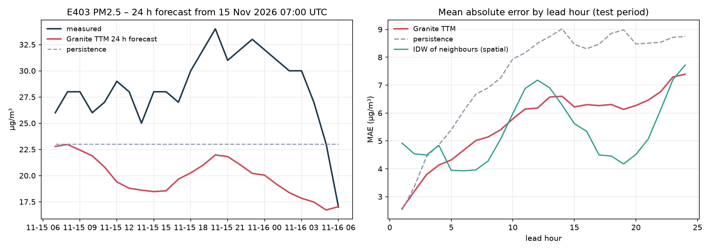

# Modeling – from the ADA Hack data package to a Granite air-quality forecaster

Everything in this folder does two things:

1. **Dataset pipeline** (`airdata/`): harmonises the 47 files of the data package
   into one tidy-long table with rows
   `time, lat, lon, altitude_m, pollutant, value` (+ provenance):
   **10,701,175 rows**, 2013–2026, measurements + models + estimates.
2. **Granite model** (`train_granite.py`): fine-tunes **IBM Granite TimeSeries
   (TTM r2)** on hourly PM10/PM2.5 from official stations in and around the
   Ljubljana basin, forecasting **1–24 h ahead** (with 1–12 h reported
   separately) and evaluated on the **last two weeks** of data.

Nothing outside `modeling/` is modified. The data package is read (not copied)
from the parent folder.

---

## Headline result

Fine-tuned Granite TTM, test period **7 Nov 2026 07:00 – 21 Nov 2026 08:00 UTC**
(the last 14 days of data, never seen in training), **24 h horizon**, scored per
lead-time block:

| Horizon | Granite TTM fine-tuned | Granite TTM zero-shot | Persistence | Skill vs persistence |
|---|---:|---:|---:|---:|
| **1–12 h** | **4.70 µg/m³ MAE** | 4.76 | 6.02 | **+21.9 %** |
| **13–24 h** | **6.55 µg/m³ MAE** | 6.58 | 8.65 | **+24.3 %** |
| **1–24 h** | **5.62 µg/m³ MAE** | 5.67 | 7.33 | **+23.3 %** |

High-pollution days only (observed daily mean > 25 µg/m³):

| Horizon | MAE | Persistence | Skill |
|---|---:|---:|---:|
| 1–12 h | 6.34 µg/m³ | 6.28 | **−1.0 %** |
| 1–24 h | 8.23 µg/m³ | 7.99 | **−3.0 %** |

Spatial check — predicting a station from its **neighbours'** forecasts
(leave-one-out inverse-distance weighting, 60 km radius):

| Horizon | Station-specific model | Neighbour IDW |
|---|---:|---:|
| 1–12 h | 4.70 | 4.99 |
| 1–24 h | 5.62 | **5.32** |



The left panel is the highest-pollution 24 h window in the test period (E403
Bežigrad PM2.5, November 2026). The right panel shows error by lead hour: the
model's advantage over persistence grows with lead time, and at 13–24 h a
neighbour-blended forecast is slightly better than a single station's model.

The honest reading: fine-tuning beats zero-shot by a small margin at every lead
block, and both beat persistence by ~22–24 %. On polluted days there is **no
skill over persistence** — in stagnant winter conditions the last measurement is
a very strong predictor and a 24 h model without weather input cannot beat it.
The two-week test is short (293 windows, 6,892 scored hours); per-series 1–24 h
MAE ranges from 3.91 (E414 Hrastnik PM2.5) to 6.97 µg/m³ (E404 Vič PM10), so
treat the ranking as indicative.

---

## Layout

```
modeling/
├── airdata/                     dataset pipeline package
├── build_dataset.py             convenience wrapper
├── prepare_timeseries.py        tidy dataset -> regular hourly series
├── train_granite.py             fine-tune Granite TTM, evaluate, save
├── forecast.py                  forecast for a station or an arbitrary lat/lon
├── spatial.py                   haversine + inverse-distance weighting
├── report.py                    metrics tables + figures
├── data/                        generated datasets (git-ignored, 52 MB)
│   ├── processed/lj_air_dataset/
│   └── model_input/
├── artifacts/granite-ttm-lj/    fine-tuned model + evaluation
│   ├── model/                   HuggingFace checkpoint (3.2 MB)
│   ├── metrics.json
│   ├── metrics_summary.md
│   ├── predictions_test.parquet (lat/lon on every row)
│   ├── episode_example.png
│   ├── training_log.csv
│   └── run_config.json
├── tests/                       17 tests
└── docs/PIPELINE.md             dataset pipeline documentation
```

---

## Dataset

`python -m airdata build` reads every source in the package:

| Type | Sources | Rows |
|---|---|---:|
| measurement | ARSO PM hourly, ARSO live feed, EEA validated + 2026 UTD, PurpleAir, Sensor.Community | 2.17 M |
| estimate | calibrated citizen sensors | 0.28 M |
| model | CAMS 0.1°, CAMS forecast, CAMx 4.4 km, GRAL 15 m | 8.25 M |

Output (`data/processed/lj_air_dataset/`):

* `lj_air.parquet` – 10,701,175 rows, 18 columns, 40 MB
* `lj_air_primary.parquet` – 2,033,997 rows: measurements only, exactly one value
  per `(station, time, pollutant, aggregation)`; priority ARSO direct > ARSO
  live > EEA > PurpleAir > Sensor.Community
* `stations.csv`, `manifest.json` (per-source counts/drops/coverage),
  `data_dictionary.md`, `README.md`

Core columns are exactly the requested ones; the provenance columns make the
data honest: `source`, `value_type` (`measurement` / `model` / `estimate`),
`quality`, `altitude_source`, `lead_h`, `issued_utc`. Units are µg/m³, time is
UTC. Details and caveats: [docs/PIPELINE.md](docs/PIPELINE.md).

Build checks: **0 duplicates**, altitude coverage **100 %** (station metadata,
30 m Copernicus DEM fallback), 11,170 negative values kept and flagged,
0 unparseable values. `python -m airdata verify` re-checks the written file.

---

## Granite model

**Base model:** [`ibm-granite/granite-timeseries-ttm-r2`](https://huggingface.co/ibm-granite/granite-timeseries-ttm-r2)
– IBM Granite TimeSeries, TinyTimeMixer architecture, **805,280 parameters**,
Apache-2.0. A time-series foundation model, not an LLM.

**Why this Granite model?** The data are hourly numeric series. The machine has
no GPU and 7 GB RAM, so fine-tuning a Granite language model (2B+) is not
feasible; Granite TTM is IBM's Granite model for exactly this task and trains
on CPU in minutes.

**Task:** given the last **512 hours** (21 days) of one series, forecast the
next **24 hours**. Longer horizons were dropped on purpose: from a measured
decay of skill, 24 h is where the model still clearly beats persistence, and it
matches the decision horizon for a citizen-facing warning. Two lead blocks are
reported separately — **1–12 h** (same-day planning) and **13–24 h** (next
morning) — because error grows markedly between them (4.70 → 6.55 µg/m³ MAE).
Inputs are raw µg/m³; TTM standardises each context window internally. The
model sees no weather and no other stations' data.

**Training data:** 11 official ARSO/EEA series (PM10 and PM2.5) from E403
Bežigrad, E404 Vič, E405 Celovška, E413 Trbovlje, E414 Hrastnik, E415 Zagorje,
E417 Kranj; 551,088 hourly values, 98–99.9 % coverage. Every series carries its
station coordinates, which are attached to predictions and used by the spatial
layer below. Low-cost citizen sensors (PurpleAir, Sensor.Community) are excluded
from training by default because they are uncalibrated;
`prepare_timeseries.py --include-citizen-sensors` includes them.

**Splits (chronological, no leakage):**

| Split | Period | Windows |
|---|---|---:|
| train | 2015-12-31 – 2026-09-08 | 10,939 |
| valid | 2026-09-08 – 2026-11-07 | 650 |
| test | 2026-11-07 – 2026-11-21 (last 14 days) | 293 |

The test window is defined relative to the freshest value in the series
(`--test-days 14 --valid-days 60`), so it follows the data when the package is
refreshed. Test windows use a 12 h stride (rolling-origin evaluation, 6,892
scored hours); validation uses 24 h.

**Fine-tuning:** AdamW, lr 5e-5, weight decay 0.01, batch 32, 48 h stride,
early stopping on validation MAE@1–12 h (patience 3). Ten epochs were run, best
at epoch 9 (val MAE@1–12 h = 3.078 µg/m³); **5 min 19 s of epochs on 6 CPU
cores** (about 6 min end-to-end including evaluation).
Masked MSE loss ignores missing hours. The 24 h head comes from the
`512-48-ft-r2.1` checkpoint with `prediction_filter_length=24`; because that
checkpoint uses resolution prefix tuning, every batch passes a `freq_token` (7
= hourly).

**Outputs:** the fine-tuned checkpoint (`artifacts/granite-ttm-lj/model/`),
metrics (`metrics.json`, `metrics_summary.md`), per-hour test predictions
(`predictions_test.parquet`, with lat/lon), the training log, and the run config.

### Forecast example

```bash
python forecast.py --station E403 --pollutant pm25
```

```
E403 / pm25: forecast from 2026-11-21 08:00:00+00:00 (LJ Bežigrad, 46.0655, 14.5127)
first 12 h: mean 9.6, max 13.6 µg/m³; 13-24 h: mean 11.8, max 14.5 µg/m³
```

The evening peak matches the known ARSO pattern (21–23 local time), which the
model learned from the data.

### Forecasting an arbitrary point (lat/lon)

```bash
python forecast.py --lat 46.0516 --lon 14.5059 --pollutant pm25 --k 3
```

The three nearest stations are weighted by inverse distance (haversine, power 2,
60 km cap): E403 (1.6 km, 44 %), E404 (2.0 km, 33 %), E405 (2.7 km, 22 %). Every
output row carries `lat`, `lon`, `horizon_group` (`1_12h` / `13_24h`) and the
contributing `stations`. This is the recommended way to answer "what will PM2.5
be at this address" — the fine-tuned model predicts each station, then IDW
blends them at the requested coordinate. The leave-one-out check above shows
this is competitive with station-specific forecasts (and better at 13–24 h),
even though the model itself has no spatial input.

---

## Quick start

The virtual environment is already provisioned in `.venv/` (Python 3.12, CPU
torch, granite-tsfm). To recreate it:

```bash
cd modeling
python -m venv .venv && . .venv/bin/activate
pip install torch --index-url https://download.pytorch.org/whl/cpu
pip install -r requirements.txt
pip install --no-deps granite-tsfm   # granite-tsfm pins torch<2.12; --no-deps avoids the resolver conflict
```

Then:

```bash
# 1. build the dataset (~1 min, 10.7M rows) and check it
python -m airdata build
python -m airdata verify
python -m airdata inspect

# 2. build model-ready hourly series
python prepare_timeseries.py

# 3. fine-tune Granite TTM (~6 min on CPU) and evaluate
python train_granite.py

# 4. report tables/figures
python report.py

# 5. forecast
python forecast.py --station E403 --pollutant pm25
```

Once the dataset exists, `python -m airdata build --sources measurements`
(2.2M rows) is a fast way to rebuild only observations.

---

## What the model is *not*

* It is not a regulatory or health-warning system. It is a research prototype.
* It forecasts one station at a time from that station's own history. It has no
  weather, traffic or emission inputs, so it cannot predict the *onset* of a new
  inversion; it extrapolates learned daily/weekly patterns and persistence.
  That is exactly why it loses to persistence on already-polluted days. Adding
  weather/ERA5 and inversion indicators as exogenous channels is the obvious
  next step.
* It is capped at 24 h. Beyond that, the measured skill over persistence
  collapses (an earlier 96 h version reached only +3.4 % on polluted days), so
  the extra horizon would be noise dressed up as a forecast.
* The test period is only two weeks (293 windows / 6,892 hours). Skill varies
  per station: 1–24 h MAE from 3.91 to 6.97 µg/m³, and E405 PM10 is slightly
  worse than persistence at 1–12 h. A longer held-out period would be more
  stable.
* The spatial layer interpolates station forecasts; it does not learn spatial
  structure (no graph/CNN). It also assumes the nearest stations represent the
  point, which fails in complex terrain (Ljubljana basin edges, Trbovlje valley).
* Citizen sensors are not used in training; that keeps the target consistent
  with reference measurements but reduces spatial density.
* No uncertainty intervals are produced (point forecasts only).

**Next steps:** exogenous weather channels, per-station embeddings, quantile
heads for "how likely is a 50 µg/m³ day?", and a citizen-facing layer that
combines the 12 h forecast with the current measurement, the lat/lon blend and a
clear measurement/model label.

---

## Attribution and licences

ARSO (measurements, CAMx, GRAL, live feed), EEA (Air Quality e-Reporting),
PurpleAir, Sensor.Community (ODbL), Open-Meteo / CAMS (CC BY 4.0), Copernicus
DEM, IBM Granite TimeSeries TTM (Apache-2.0). The generated
`data_dictionary.md` repeats per-source attribution. When publishing results,
cite: *Vir: ARSO; EEA; Open-Meteo/CAMS; PurpleAir; Sensor.Community (ODbL).*
