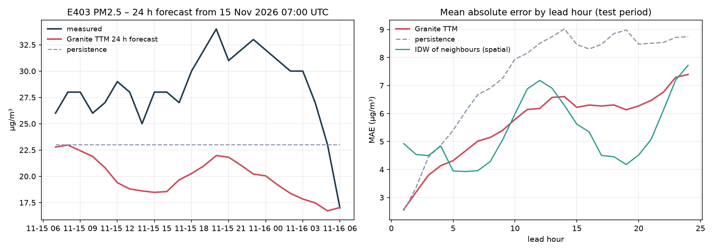

# Granite TTM – evaluation summary

Base model: `ibm-granite/granite-timeseries-ttm-r2`  
Test period: 2026-11-07 07:00:00+00:00 – 2026-11-21 08:00:00+00:00  
Horizon: 24 h

## All test windows

| Horizon | Granite TTM MAE | RMSE | Zero-shot MAE | Persistence MAE | Skill |
|---|---:|---:|---:|---:|---:|
| 1–12 h | 4.70 | 6.55 | 4.76 | 6.02 | +21.9 % |
| 13–24 h | 6.55 | 8.62 | 6.58 | 8.65 | +24.3 % |
| 1–24 h | 5.62 | 7.65 | 5.67 | 7.33 | +23.3 % |

## High-pollution days (observed daily mean > 25 µg/m³)

| Horizon | MAE | RMSE | Persistence MAE | Skill |
|---|---:|---:|---:|---:|
| 1–12 h | 6.34 | 8.51 | 6.28 | -1.0 % |
| 1–24 h | 8.23 | 10.36 | 7.99 | -3.0 % |

## Spatial layer: predicting a station from its neighbours (leave-one-out IDW)

| Horizon | Station model MAE | IDW of neighbours MAE |
|---|---:|---:|
| 1–12 h | 4.70 | 4.99 |
| 1–24 h | 5.62 | 5.32 |

## By series (24 h, test period)

| Station | Pollutant | MAE 1–12 h | MAE 1–24 h | Persistence 1–24 h | Skill 1–24 h | n |
|---|---|---:|---:|---:|---:|---:|
| E403 | pm10 | 4.86 | 6.25 | 6.81 | +8.2 % | 632 |
| E403 | pm25 | 4.13 | 5.40 | 5.71 | +5.3 % | 632 |
| E404 | pm10 | 5.71 | 6.97 | 7.54 | +7.6 % | 612 |
| E404 | pm25 | 5.17 | 6.33 | 6.74 | +6.1 % | 612 |
| E405 | pm10 | 4.91 | 5.96 | 6.28 | +5.0 % | 612 |
| E405 | pm25 | 4.07 | 5.08 | 5.54 | +8.4 % | 612 |
| E413 | pm10 | 5.07 | 5.78 | 8.33 | +30.7 % | 636 |
| E413 | pm25 | 4.60 | 5.24 | 7.44 | +29.5 % | 636 |
| E414 | pm25 | 3.33 | 3.91 | 5.48 | +28.6 % | 636 |
| E415 | pm25 | 5.39 | 5.89 | 11.08 | +46.8 % | 636 |
| E417 | pm25 | 4.51 | 5.12 | 9.60 | +46.7 % | 636 |

The left panel is the 24 h forecast window with the highest measured daily mean
in the test period. The right panel shows error by lead hour, including the
spatial IDW layer that predicts a station from its neighbours' forecasts.
